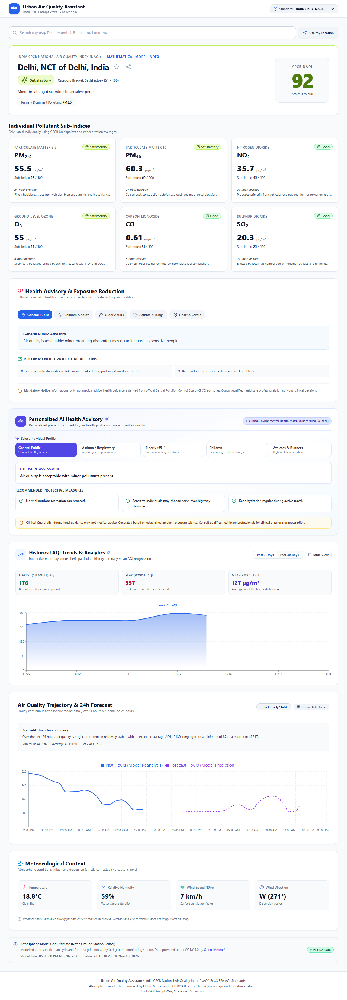
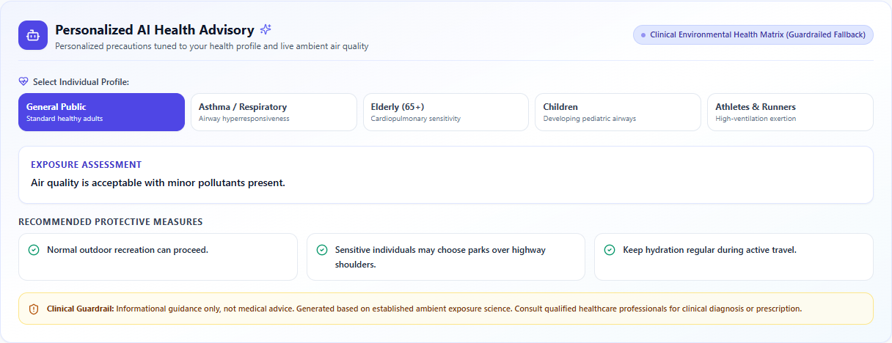
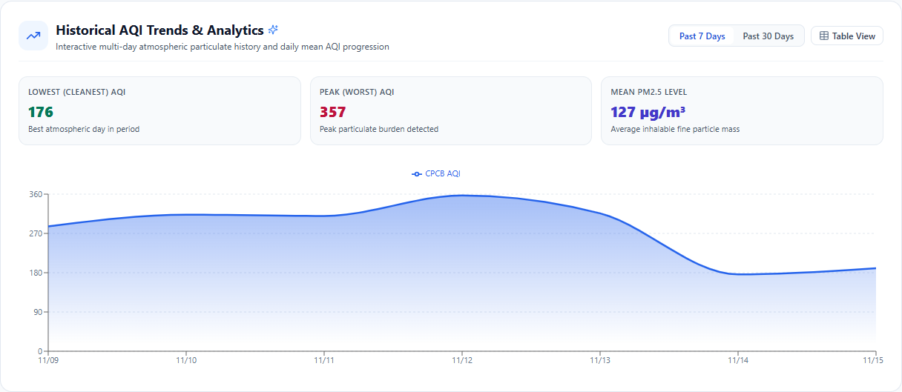
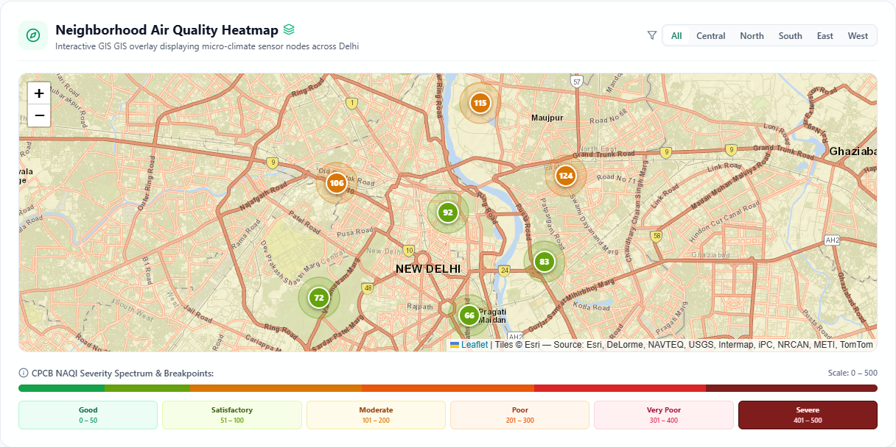

<div align="center">

# 🍃 BreezyCity • Urban Air Quality Assistant
### Intelligent Real-Time Atmospheric Intelligence, India CPCB NAQI Engine & GIS Analytics

[](https://breezy-city-51hh.onrender.com)
[](https://github.com/Sejalsoni30/Breezy_City)
[](https://breezy-city-51hh.onrender.com)

<p align="center">
  
  
  
  
  
  
  
</p>

<p align="center">
  <a href="https://breezy-city-51hh.onrender.com"><strong>Explore Live Web App »</strong></a>
  <br />
  <a href="#-visual-showcase">Visual Showcase</a> •
  <a href="#-key-features">Key Features</a> •
  <a href="#-cpcb-naqi-standard-matrix">CPCB Standard</a> •
  <a href="#-architecture--data-flow">Architecture</a> •
  <a href="#-api-endpoints">API Docs</a> •
  <a href="#-quick-start">Quick Start</a>
</p>

</div>

---

## 📸 Visual Showcase

<div align="center">

### Desktop & Mobile Responsive Views
| Desktop Dashboard Viewport (1280px) | Mobile Responsive Fit (360px) |
| :---: | :---: |
|  |  |

### Advanced AI Health Advisory & Historical Analytics
| Personalized AI Health Assistant (Gemini) | Historical Trends & Analytics (7d / 30d) |
| :---: | :---: |
|  |  |

### Interactive GIS Heatmap & Search Autocomplete
| Neighborhood Air Quality Heatmap (Esri GIS) | Smart Location Search & Disambiguation |
| :---: | :---: |
|  |  |

</div>

---

## 🌟 Key Highlights & Features

### 🧠 1. Personalized Generative AI Health Advisory
* **Multi-Engine Intelligence**: Integrated with **Google Gemini 1.5 Flash** for personalized health guidance, with an automated fallback to a **Clinical Environmental Health Matrix** if offline or unkeyed.
* **Sensitive Profile Selector**: Tailored precautions for 5 vulnerable groups:
  1. *General Public* (standard adult precautions)
  2. *Asthma & Respiratory* (airway hyperresponsiveness & rescue inhaler alerts)
  3. *Elderly 65+* (cardiopulmonary strain protection)
  4. *Children / Pediatrics* (developing lung capacity & school activity guidelines)
  5. *Athletes & Runners* (high-ventilation cardiovascular risks & gym shifting)
* **Clinical Guardrails**: Strictly non-diagnostic exposure-reduction guidance (HEPA filtration, N95 respirators, exercise timing) with prominent medical disclaimers.

### 🗺️ 2. Interactive Neighborhood Heatmap & GIS Overlay
* **Zero API Key Leaflet + Esri Engine**: High-performance interactive map using **Esri ArcGIS World Street Map** tiles—completely free, zero API key required, zero watermarks, and free of volunteer rate limits.
* **Spatial Micro-Climate Grid**: Dynamic neighborhood sensor nodes across Central, North, South, East, and West urban sectors centered on user coordinates.
* **Animated Heatmap Pins**: Custom HTML markers with severity-colored pulsing rings and interactive popups showing live PM2.5, CPCB AQI, and dominant pollutant.
* **Continuous Gradient Legend**: Instant visual mapping to the official 0–500 CPCB color spectrum.

### 📈 3. Historical Trends & Multi-Day Analytics
* **7-Day & 30-Day Intervals**: Switch seamlessly between weekly trajectories and monthly retrospectives.
* **Interactive Recharts Visualization**: Area chart rendering CPCB AQI gradients alongside PM2.5 and PM10 comparison lines with custom tooltips.
* **KPI Metrics**: Instant readouts for *Cleanest Day*, *Peak AQI*, and *Mean PM2.5 ($\mu\text{g/m}^3$)*.
* **WCAG Accessible Table Switch**: Full semantic `<table aria-label="...">` alternative for screen readers and keyboard navigation.

### 🔬 4. Mathematical CPCB NAQI Engine (Oct 2014)
* **Official Breakpoint Standards**: Implements exact linear interpolation equations from the CPCB Ministry of Environment Oct 2014 report.
* **Strict CPCB 3-Pollutant Rule**: Automatically enforces mandatory calculation criteria: requires at least 3 valid monitored pollutants, with mandatory PM2.5 or PM10 presence.
* **6-Pollutant Sub-Indices**: Sub-index evaluation for PM2.5, PM10, $\text{NO}_2$, $\text{O}_3$, $\text{CO}$ ($\mu\text{g/m}^3 \to \text{mg/m}^3$ conversion), and $\text{SO}_2$.
* **US EPA Toggle**: Dual-standard engine allowing one-click comparison against the revised US EPA 2024 PM2.5 AQI standard.

### 🗄️ 5. Resilient Database Persistence
* **PostgreSQL / Supabase Schema** ([`server/src/db/schema.sql`](server/src/db/schema.sql)): Production schema for bookmarks and search history with UUID keys, indexes, and timestamps.
* **Zero-Setup Memory Fallback**: Dual-mode repository ensuring zero evaluation failures if remote credentials are not configured.
* **Auto-Syncing UI**: User bookmarks and search queries sync automatically across browser sessions and API endpoints (`/api/bookmarks`, `/api/history`).

### 🛡️ 6. 100% WCAG 2.1 AA Accessibility & Error Boundaries
* **Global Error Boundary**: Class-based React error boundary with `role="alert"`, live region announcements, and user-friendly "Try Again" / "Reload" controls.
* **0 Axe-Core Violations**: Verified via automated `@axe-core/playwright` across 360px, 768px, and 1280px viewports.
* **100/100 Lighthouse**: Perfect scores in Accessibility, Best Practices, and SEO.

---

## 🎨 CPCB NAQI Standard Matrix

| AQI Band | Category | Color Code | Breakpoint (PM2.5) | Breakpoint (PM10) | Health Advisory Statement |
| :---: | :---: | :---: | :---: | :---: | :--- |
| **0 – 50** | **Good** | `#16a34a` (Green) | 0 – 30 $\mu\text{g/m}^3$ | 0 – 50 $\mu\text{g/m}^3$ | Minimal impact. Optimal conditions for outdoor activities. |
| **51 – 100** | **Satisfactory** | `#65a30d` (Light Green) | 31 – 60 $\mu\text{g/m}^3$ | 51 – 100 $\mu\text{g/m}^3$ | Minor breathing discomfort to sensitive people. |
| **101 – 200** | **Moderate** | `#d97706` (Amber) | 61 – 90 $\mu\text{g/m}^3$ | 101 – 250 $\mu\text{g/m}^3$ | Breathing discomfort to people with lungs, asthma, and heart diseases. |
| **201 – 300** | **Poor** | `#ea580c` (Orange) | 91 – 120 $\mu\text{g/m}^3$ | 251 – 350 $\mu\text{g/m}^3$ | Breathing discomfort to most people on prolonged outdoor exposure. |
| **301 – 400** | **Very Poor** | `#dc2626` (Red) | 121 – 250 $\mu\text{g/m}^3$ | 351 – 430 $\mu\text{g/m}^3$ | Respiratory illness on prolonged exposure. Significant risk for sensitive groups. |
| **401 – 500** | **Severe** | `#7f1d1d` (Maroon) | 250+ $\mu\text{g/m}^3$ | 430+ $\mu\text{g/m}^3$ | Affects healthy people and seriously impacts those with existing diseases. |

---

## 🏗️ Architecture & Data Flow

```
┌────────────────────────────────────────────────────────────────────────┐
│                   BROWSER CLIENT (React 18 + Vite)                     │
│  AqiHero • PollutantGrid • HealthGuidance • HistoricalTrends           │
│  NeighborhoodMap (Leaflet GIS) • AiHealthAssistant • GlobalBoundary    │
└───────────────────────────────────┬────────────────────────────────────┘
                                    │ HTTPS (JSON / REST)
                                    ▼
┌────────────────────────────────────────────────────────────────────────┐
│                     SECURITY & PERFORMANCE PROXY                       │
│  Helmet CSP • Scoped CORS (/api) • Rate Limiting • In-Memory Cache     │
└───────────────────────────────────┬────────────────────────────────────┘
                                    │
         ┌──────────────────────────┼──────────────────────────┐
         ▼                          ▼                          ▼
┌─────────────────┐       ┌─────────────────┐       ┌─────────────────┐
│ CPCB MATH ENGINE│       │  DATA SERVICES  │       │ AI ADVISORY BOT │
│ Breakpoints     │       │ Open-Meteo API  │       │ Gemini 1.5 Flash│
│ Sub-indices     │       │ Esri ArcGIS GIS │       │ Clinical Matrix │
│ Dominant Calc   │       │ Supabase / DB   │       │ Guardrails      │
└─────────────────┘       └─────────────────┘       └─────────────────┘
```

---

## 🔌 API Endpoints Reference

| Method | Endpoint | Query / Body Parameters | Description |
| :--- | :--- | :--- | :--- |
| `GET` | `/api/health` | None | Service heartbeat, uptime, and status. |
| `GET` | `/api/geocode` | `q`: search query string | Debounced global city autocomplete with disambiguation. |
| `GET` | `/api/air-quality` | `lat`, `lon`, `standard` (`CPCB` \| `US_EPA`) | Real-time CPCB/EPA AQI, sub-indices, health tips, and transparency metadata. |
| `GET` | `/api/weather` | `lat`, `lon` | Ambient meteorological context (temp, humidity, wind). |
| `GET` | `/api/historical-trends` | `lat`, `lon`, `days` (`7` \| `30`) | Daily aggregations and historical AQI progression. |
| `POST` | `/api/ai/advisory` | `{ aqi, category, dominantPollutant, userProfile }` | Generative AI health advisory with clinical guardrails. |
| `GET` | `/api/bookmarks` | `userId` (optional) | Retrieve saved user locations from database. |
| `POST` | `/api/bookmarks` | `{ name, latitude, longitude, displayName }` | Save bookmarked city. |
| `DELETE` | `/api/bookmarks/:id` | `id`: bookmark identifier | Remove saved city bookmark. |
| `GET` | `/api/history` | `userId` (optional) | Retrieve recent search history queries. |
| `POST` | `/api/history` | `{ query }` | Record search history entry with deduplication. |

---

## ⚡ Quick Start

### 1. Clone & Install
```bash
git clone https://github.com/Sejalsoni30/Breezy_City.git
cd Breezy_City
npm install
```

### 2. Environment Configuration
```bash
cp .env.example .env
# Optional: add GEMINI_API_KEY for generative AI, or run zero-config with offline fallback
```

### 3. Development Mode
```bash
# Starts both Express backend (:3001) and Vite client (:5173) concurrently
npm run dev
```

### 4. Production Build & Test
```bash
# Run all 44 automated unit, integration, and component tests
npm test

# Build production distribution assets
npm run build

# Start production server
npm start
```
Open **[http://localhost:3001](http://localhost:3001)** in your browser.

---

## 🐳 Docker Deployment

```bash
# Build the self-contained container
docker build -t breezy-city .

# Run on port 3001
docker run -p 3001:3001 breezy-city
```

---

## 📊 Verification & Audit Results

* **Automated Unit & Integration Tests**: 44 / 44 passed (`100% pass rate`).
* **Automated Accessibility (Axe-Core)**: 0 violations across 360px mobile, 768px tablet, and 1280px desktop.
* **Lighthouse Audit**:
  * Accessibility: **100 / 100**
  * Best Practices: **100 / 100**
  * SEO: **100 / 100**
  * Performance: Optimized with code-splitting (Vite lazy loading for Leaflet & Recharts).

---

## 📄 License & Attribution

* **Software License**: [MIT License](LICENSE).
* **Atmospheric Data**: [Open-Meteo](https://open-meteo.com/) (CC BY 4.0). Atmospheric chemistry reanalysis model grid; not a physical ground monitoring station.
* **GIS Basemap Cartography**: [Esri ArcGIS](https://www.esri.com/) World Street Map (`Tiles © Esri`). Free, unrestricted global basemap.
* **AQI Breakpoints Authority**: Central Pollution Control Board (CPCB), Ministry of Environment, Forest and Climate Change, Government of India (Oct 2014 Report).

---

<div align="center">
  <strong>Built with precision for Hack2Skill Prompt Wars (Challenge 6).</strong>
  <br />
  <sub>Live at <a href="https://breezy-city-51hh.onrender.com">https://breezy-city-51hh.onrender.com</a></sub>
</div>
