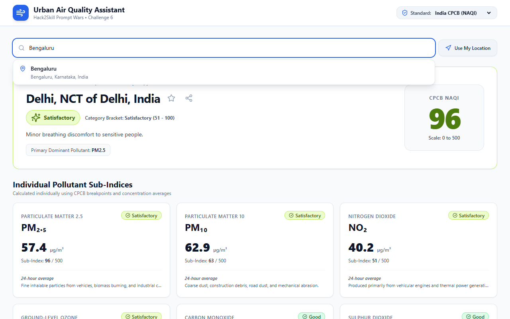
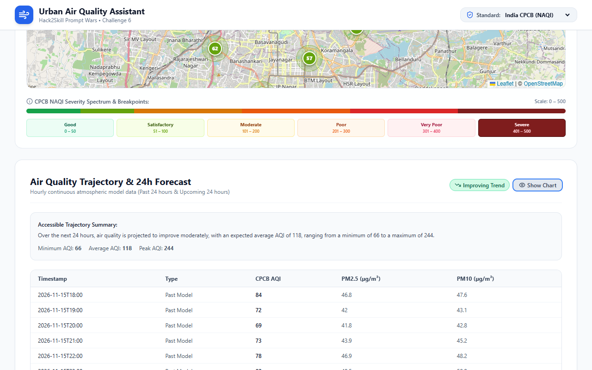

# Urban Air Quality Assistant

[](https://breezy-city-51hh.onrender.com)
[](file:///docs/TEST_REPORT.md)
[-blue)](file:///docs/TEST_REPORT.md)
[](https://cpcb.nic.in/)
[](LICENSE)

An intelligent, accessible, and scientifically grounded air quality platform built to provide real-time atmospheric intelligence, India CPCB National Air Quality Index (NAQI) calculations, individual pollutant breakdowns, vulnerable group health advisories, and contextual weather metrics.

🌐 **Live Deployment**: [https://breezy-city-51hh.onrender.com](https://breezy-city-51hh.onrender.com)

> **Competition Context**: Submitted for **[Challenge 6] Urban Air Quality Assistant**, Hack2Skill Prompt Wars. Product architecture, implementation, and branding are independent and production-ready.

---

## 📸 Visual Verification & Responsive Showcase

| Desktop Viewport (1280px) | Mobile Viewport (360px) |
| :---: | :---: |
|  |  |

| Autocomplete Search & Disambiguation | Accessible Trends Table Alternative |
| :---: | :---: |
|  |  |

---

## 🌟 Key Features

### Mandatory Baseline Features (`[MANDATORY-BASELINE]`)
- **Real-Time CPCB NAQI Calculation**: Implements the official October 2014 Central Pollution Control Board (CPCB) NAQI mathematical formulas, linear interpolations, and boundary rules across all 6 categories (Good, Satisfactory, Moderate, Poor, Very Poor, Severe).
- **Dominant Pollutant & 3-Pollutant Rule**: Automatically enforces CPCB criteria: requires at least 3 valid monitored pollutants, with mandatory PM2.5 or PM10 presence, and calculates dominant pollutant(s).
- **Sub-Indices for 6 Core Pollutants**: Real-time evaluation of PM2.5, PM10, Nitrogen Dioxide ($\text{NO}_2$), Ozone ($\text{O}_3$), Carbon Monoxide ($\text{CO}$ with $\mu\text{g/m}^3 \to \text{mg/m}^3$ conversion), and Sulphur Dioxide ($\text{SO}_2$).
- **Data Nature Transparency**: Explicitly discloses that readings are **atmospheric numerical model grid estimates** (Open-Meteo atmospheric chemistry reanalysis) rather than physical ground station measurements, badged with observation and retrieval timestamps.
- **Location Search & Disambiguation**: Debounced search with dropdown disambiguation (e.g. distinguishing Delhi, India from Delhi, New York), keyboard navigation (Arrow keys, Enter, Escape), and request cancellation.
- **Privacy-Preserving Geolocation**: Browser geolocation trigger with graceful handling of denial, timeout, and device incompatibility. Coordinates are rounded to 3 decimal places ($\approx 110\text{m}$) before transmission and never logged.
- **Sensitive Group Health Advisories**: Rule-based, deterministic health advice tailored to Children, Older Adults, individuals with Asthma/Lung diseases, and Cardiovascular conditions, paired with practical exposure reduction checklists and medical disclaimers.
- **24-Hour Trajectory & Forecast Trends**: Continuous time series showing past 24h model reanalysis and 24h forecast, paired with an accessible plain-language summary and a toggleable data table.
- **Meteorological Context**: Temperature, relative humidity, wind speed, and wind direction displayed strictly as ambient context (no unfounded causal claims).
- **Full UI Resilience**: Graceful error banners with retry triggers, loading skeletons, offline detection, and partial data tolerance.
- **WCAG 2.1 AA Accessibility**: High-contrast category colors paired with visible icons and text labels, skip-to-content link, `role="combobox"` keyboard navigation, and zero Axe-core violations.

---

## 🏗️ Architecture & Technology Stack

```
urban-air-quality-assistant/
├── server/                     # Express + TypeScript Proxy & AQI Engine
│   ├── src/
│   │   ├── aqi/               # CPCB breakpoints, mathematical formulas, health guidance, trends
│   │   ├── services/          # Open-Meteo client, in-memory cache & deduplicator
│   │   ├── middleware/        # Zod input validation, Helmet headers, CORS, rate limiting
│   │   └── app.ts / server.ts # Server startup & static asset handler
│   └── test/                  # Unit (breakpoint boundaries) & Integration (Supertest) tests
├── client/                     # React 18 + Vite + Tailwind CSS Frontend
│   ├── src/
│   │   ├── components/        # AqiHero, PollutantGrid, HealthGuidance, TrendsChart, Search
│   │   └── App.tsx            # Main layout, offline listener, and data orchestrator
│   └── test/                  # Vitest + React Testing Library component tests
├── docs/                      # Architectural specs, requirements, test reports, security audits
└── scripts/                   # Playwright E2E and visual verification suite
```

### Technology Justifications
- **React 18 + Vite**: Fast declarative UI with instant HMR and optimized production bundling.
- **Tailwind CSS**: Utility-first styling with accessible contrast ratios and responsive breakpoints.
- **Node.js + Express**: Secure proxy layer shielding third-party APIs, enforcing rate limits, and computing AQI server-side.
- **Zod**: Strict runtime schema validation preventing injection and coordinate overflow.
- **Helmet & CORS**: Hardened security headers (CSP, noSniff, frameguard) and strict origin restrictions.
- **Recharts (Lazy-Loaded)**: Code-split into a separate chunk (`436 kB`), keeping the initial application bundle lightweight (`190 kB` / `58 kB` gzip).
- **Vitest, Supertest & Playwright**: Multi-tiered automated test suite covering unit math, integration endpoints, end-to-end user flows, and automated Axe accessibility.

---

## 📊 Data Providers & Attribution

- **Provider**: [Open-Meteo](https://open-meteo.com/) Air Quality API, Geocoding API, and Weather Forecast API.
- **License**: Creative Commons Attribution 4.0 International (CC BY 4.0).
- **Data Transparency**: Open-Meteo air quality data originates from atmospheric numerical model grids (such as ECMWF CAMS reanalysis and forecasts). It provides spatial continuity across urban grids, but does not represent direct sensor readings from physical monitoring stations.

---

## 📐 AQI Standard & Breakpoint Authority

- **Active Standard**: India CPCB National Air Quality Index (NAQI).
- **Authority**: Central Pollution Control Board (CPCB), Ministry of Environment, Forest & Climate Change, Government of India.
- **Source Publication**: *National Air Quality Index* Report (October 2014, Tables 1 & 2).
- **Breakpoints**: Hardcoded in `server/src/aqi/cpcbBreakpoints.ts` with direct citations and boundary unit tests.

---

## ⚡ Quick Start & Commands

### Prerequisites
- Node.js `v18+` (Tested on `v24.14.1`)
- npm `v9+` (Tested on `v11.11.0`)
- Google Chrome (for automated Playwright verification)

### 1. Install Dependencies
```bash
npm install
```

### 2. Environment Setup
```bash
# Copy example configuration (no third-party API keys required)
cp .env.example .env
```

### 3. Run in Development Mode
```bash
# Starts both Express backend (:3001) and Vite client (:5173) concurrently
npm run dev
```

### 4. Build for Production
```bash
# Compiles backend TypeScript and builds optimized client assets
npm run build
```

### 5. Run in Production Mode
```bash
# Starts the backend, which automatically serves the production client build on port 3001
npm start
```
Open [http://localhost:3001](http://localhost:3001) in your browser.

### 6. Run Test Suite
```bash
# Runs all 35 automated unit, integration, and component tests
npm test

# Run Playwright E2E and Axe accessibility verification
node scripts/verifyAndScreenshot.mjs
```

---

## 🚀 One-Click Cloud Deployment

### Option A: Deploy to Render (Recommended - Free Tier)
1. Go to [Render Dashboard](https://dashboard.render.com/) and click **New +** > **Web Service**.
2. Connect your GitHub repository: `https://github.com/Sejalsoni30/Breezy_City`.
3. Configure the service:
   - **Environment**: `Node`
   - **Build Command**: `npm install && npm run build`
   - **Start Command**: `npm start`
   - **Plan**: `Free`
4. Click **Create Web Service**. Your live app will be published on a permanent HTTPS URL (e.g., `https://breezy-city.onrender.com`).

### Option B: Deploy with Docker
```bash
# Build the production Docker container
docker build -t breezy-city-aqi .

# Run container on port 3001
docker run -p 3001:3001 breezy-city-aqi
```

---

## 🔒 Security Summary

- **Zero Secrets Committed**: `.env` is gitignored; `.env.example` provides default configuration.
- **Strict Parameter Validation**: Latitude (-90 to +90) and Longitude (-180 to +180) enforced via Zod. Malformed queries are rejected with `400 Bad Request`.
- **Rate Limiting**: 100 requests per minute per IP via `express-rate-limit`.
- **Location Privacy**: Coordinates are rounded to 3 decimal places before caching or transmission and are never stored in server access logs.
- For full details, see [docs/SECURITY_AUDIT.md](docs/SECURITY_AUDIT.md).

---

## ⚠️ Known Limitations

1. **Atmospheric Model Resolution**: Open-Meteo air quality data is grid-based ($\approx 10\text{km}$ resolution). Micro-climates or localized street-level emissions (e.g. direct traffic exhausts at an intersection) may vary from the regional model estimate.
2. **Missing Pollutants in Remote Areas**: Certain rural coordinates may lack continuous sensor reanalysis for all 6 pollutants. When fewer than 3 pollutants are available, CPCB NAQI calculation is marked unavailable as mandated by CPCB guidelines.
3. **Browser Geolocation**: Geolocation requires an HTTPS origin or `localhost` in modern browsers and depends on user device permission.

---

## 📄 Documentation Index
- [Requirements Traceability Matrix (docs/REQUIREMENTS.md)](docs/REQUIREMENTS.md)
- [Architecture & Design Specification (docs/ARCHITECTURE.md)](docs/ARCHITECTURE.md)
- [Verification & Test Report (docs/TEST_REPORT.md)](docs/TEST_REPORT.md)
- [Security Audit & Threat Model (docs/SECURITY_AUDIT.md)](docs/SECURITY_AUDIT.md)
- [Visual Screenshots Directory (docs/screenshots/)](docs/screenshots/)
